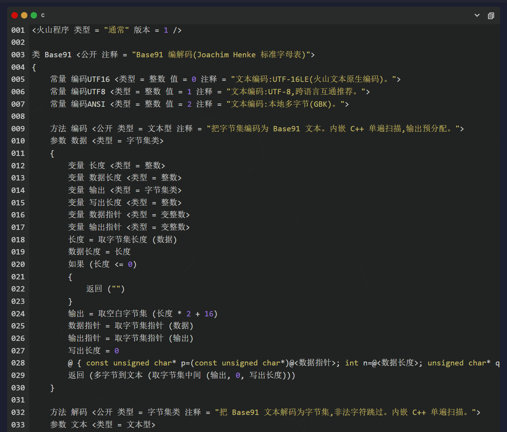

<h1>
  &nbsp;&nbsp;火山源码高亮可视化
</h1>

<p>
  <a href="https://github.com/NanX3366/voldev/actions/workflows/ci.yaml"></a>
  <a href="https://github.com/NanX3366/voldev/releases"></a>
  
  
</p>


Halo 2.x 插件：把火山中文编程开发平台的源码，按火山 IDE 的表格样式渲染成只读视图。  

- 因为中文代码的特殊性，使用代码块进行高亮代码进行展示和复制操作时，往往可阅读性非常差，所以该插件将代码还原为IDE风格样式进行展现，增强其可阅读性

## 效果预览

| 未使用插件 | 使用插件后 |
| :---: | :---: |
|  |  |

## 功能

- **按 IDE 还原的表格**：将文本格式的火山源码以近乎接近原版的外观样式展示在文章内
- **支持单独展示**：对于单独存在的变量，常量，类，包，方法均支持正常显示
- **15 套配色**：VS Code、Monokai、Dracula、Nord、GitHub、Tokyo Night、Gruvbox、Catppuccin、Solarized、One 系列，深浅都有，后台一键切换，换主题不需要重新保存文章
- **复制与逐段折叠**：标题栏的「复制」直接复制原始火山源码；每张表左侧的 −/+ 可把该段收起，只看表头结构

## 安装

1. 到 [Releases](https://github.com/NanX3366/voldev/releases) 下载最新的 `plugin-voldev-x.y.z.jar`
2. Halo 后台 → 插件 → 右上角「安装插件」→ 上传这个 jar
3. 安装后启用插件，后台左侧「插件」→ 火山源码高亮 → 设置里选配色

要求 Halo `>= 2.27.0`。

## 使用

在文章编辑器里两种方式插入：

1. **工具栏**：点编辑器工具栏的「火山代码」按钮，插入一个代码块，把火山源码粘进去
2. **斜杠命令**：输入 `/火山` 或 `/volcano` 选择「火山代码」


代码块的配色由后台「设置 → 代码配色主题」统一决定，换主题后刷新前台即生效，不需要重新保存文章。

## 配色主题

| 深色 | 浅色 |
|---|---|
| VS Code Dark+ · Monokai · Dracula · One Dark · Nord · GitHub Dark · Tokyo Night · Gruvbox Dark · Catppuccin Mocha · Solarized Dark | VS Code Light+ · GitHub Light · Solarized Light · Catppuccin Latte · One Light |

## 开发

环境要求：Java 21+、Node.js >= 22.12.0、pnpm。

```bash
# 启动带插件的 Halo 服务（开发用）
./gradlew haloServer

# 前端单独构建（改样式时用，产物会被 gradle 打进 jar）
cd ui
pnpm install
pnpm dev
```

## 构建

```bash
./gradlew build
```

产物在 `build/libs/plugin-voldev-<version>.jar`。


## 许可证

[GPL-3.0](./LICENSE) © XxX
