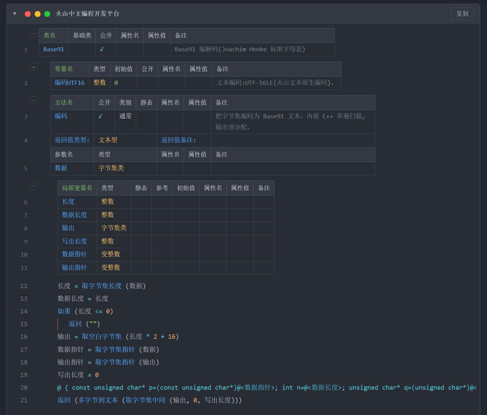

<h1>
  &nbsp;&nbsp;火山源码高亮可视化
</h1>

<p>
  <a href="https://github.com/NanX3366/voldev/actions/workflows/ci.yaml"></a>
  <a href="https://github.com/NanX3366/voldev/releases"></a>
  
  
</p>

Halo 2.x 插件：把火山中文编程开发平台导出的源码，按火山 IDE 的表格样式渲染成只读视图。粘贴进编辑器的代码会自动变成「类 / 常量 / 成员变量 / 方法 / 局部变量」几张表加代码行，比裸文本好读得多。

## 效果预览



## 功能

- **按 IDE 还原的表格**：类名、常量、成员变量、方法（含返回值和参数）、局部变量各成一张表，属性多的时候按「属性名 / 属性值」逐行展开、其余列自动合并
- **自动归属**：紧跟 `类` 下面的变量和常量算成员，方法体里算局部；只粘片段也能渲染（无法判断时一律按局部）
- **流程线**：`如果 / 循环` 按嵌套层级画竖向引导线，空块也补一行，不会断线
- **多段注释**：一个成员写了好几个 `注释 = "…"` 时逐行显示，不挤成一句
- **15 套配色**：VS Code、Monokai、Dracula、Nord、GitHub、Tokyo Night、Gruvbox、Catppuccin、Solarized、One 系列，深浅都有，后台一键切换，换主题不需要重新保存文章
- **折叠 / 源码视图 / 复制**：面板右上角三个按钮，折叠只看结构，源码视图看原文，复制拿到的是干净的代码文本

## 安装

1. 到 [Releases](https://github.com/NanX3366/voldev/releases) 下载最新的 `plugin-voldev-x.y.z.jar`
2. Halo 后台 → 插件 → 右上角「安装插件」→ 上传这个 jar
3. 安装后启用插件，后台左侧「插件」→ 火山源码高亮 → 设置里选配色

要求 Halo `>= 2.27.0`。

## 使用

在文章编辑器里两种方式插入：

1. **工具栏**：点编辑器工具栏的「火山代码」按钮，插入一个代码块，把火山源码粘进去
2. **斜杠命令**：输入 `/火山` 或 `/volcano` 选择「火山代码」

粘进去的内容就是火山 IDE 导出的文本，`<火山程序 类型 = "通常" 版本 = 1 />` 开头那种。保存后前台渲染成面板样式，编辑器里也能实时预览。

代码块的配色由后台「设置 → 代码配色主题」统一决定，换主题后刷新前台即生效，不需要重新保存文章。

## 配色主题

| 深色 | 浅色 |
|---|---|
| VS Code Dark+ · Monokai · Dracula · One Dark · Nord · GitHub Dark · Tokyo Night · Gruvbox Dark · Catppuccin Mocha · Solarized Dark | VS Code Light+ · GitHub Light · Solarized Light · Catppuccin Latte · One Light |

## 开发

环境要求：Java 21+、Node.js >= 22.12.0、pnpm。

```bash
# 启动带插件的 Halo 服务（开发用）
./gradlew haloServer

# 前端单独构建（改样式时用，产物会被 gradle 打进 jar）
cd ui
pnpm install
pnpm dev
```

## 构建

```bash
./gradlew build
```

产物在 `build/libs/plugin-voldev-<version>.jar`。

> 本机默认用 `mavenLocal` 里的 `2.28.0-SNAPSHOT` 平台依赖；CI 上没有这个快照，所以自动构建会带 `-PhaloPlatform=2.27.3` 切到 Maven Central 的正式版。

## 发版

打 tag 即触发自动构建并发布 Release，`gradle.properties` 的 `version` 必须与 tag 一致：

```bash
# 先把 gradle.properties 的 version 改成 1.0.29
git commit -am "chore: 1.0.29"
git push
git tag v1.0.29
git push origin v1.0.29
```

也可以在 Actions 页面手动触发 `Release` 工作流并填入版本号。

## 许可证

[GPL-3.0](./LICENSE) © XxX
